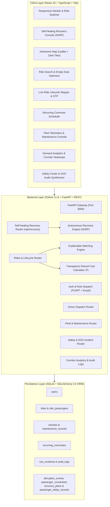

# VoltRide: Real-Time Ride Sharing, Fleet Management & Self-Healing Ride Pooling (SHRP)

> **Academic Capstone Project**: BTech Computer Science & Engineering  
> **Core Research Novelty**: Self-Healing Ride Pooling & Autonomous Recovery (SHRP) with Dynamic Confidence, Multi-Trip Fairness Budget ($\lambda = 0.8$), and Explainable AI (XAI)  
> **Status**: Fully Verified Working Prototype • 44 Tests Passed (100% Green)  

---

## 1. Executive Summary & Core Novelty

**VoltRide** is a community-agnostic, intelligent ride-pooling, fleet telematics, and autonomous resilience platform designed for university students/faculty, corporate tech park employees, airport commuters, and the general public across Indian metropolitan corridors.

### Why Self-Healing Ride Pooling (SHRP)?
In existing commercial ride-pooling platforms (e.g., Uber Pool, Ola Share), a mid-trip disruption—such as a driver cancellation, vehicle breakdown, or sudden traffic bottleneck—is treated as a **terminal failure event**:
- The current shared pool is dissolved.
- Passengers are stranded mid-corridor.
- Riders are forced to manually request a new ride, often encountering surge pricing and extended delays.
- Downstream passengers on the same pooled route suffer compounding delays without explanation.

**VoltRide solves this through autonomous, self-healing recovery**:
1. **9-Disruption Resilience Taxonomy**: Detects and recovers from `DRIVER_CANCEL`, `PASSENGER_CANCEL`, `VEHICLE_BREAKDOWN`, `TRAFFIC_CONGESTION`, `EARLY_DEPARTURE`, `ROUTE_DEVIATION`, `CAPACITY_DROP`, `WEATHER_SLOWDOWN`, and `SURGE_BLOCK`.
2. **Dynamic Multi-Objective Confidence Calculation**: Dynamically scores recovery plans using mathematically grounded weights:
   $$\text{Score} = (0.35 \cdot S_{\text{deadline}}) + (0.30 \cdot S_{\text{walking}}) + (0.20 \cdot S_{\text{fare}}) + (0.15 \cdot S_{\text{constraint}})$$
   Guaranteed strictly bounded in $[0.0, 1.0]$ with zero hardcoded confidence values.
3. **Multi-Trip Fairness Budget with Exponential Recency Decay**:
   Tracks passenger historical delay burden across trips using exponential decay ($\lambda = 0.80$ per day):
   $$\text{Burden}(u, t) = \sum_{i=1}^{K} d_i \cdot (0.80)^{\Delta t_i / 86400}$$
   Prevents greedy detour algorithms from repeatedly penalizing the same passenger.
4. **Explainable AI (XAI) Transparent Decision Making**:
   Provides clear quantitative tradeoff justifications for accepted recovery plans and explicit rule-based diagnostic reasons for discarded alternatives.
5. **Strict Indian Rupee (₹ / INR) Currency Standardization**:
   Transparent shared cost calculation with base fare ₹40.00, ₹10.00/km, and ₹1.50/min.

---

## 2. Quick Start & Execution Guide

### Prerequisites
- **Python**: 3.10+ (Verified on Python 3.14.4)
- **Node.js**: Node 18+ (Verified on Node v24.14.1, npm 11.11.0)
- **Database**: SQLite (Runs locally out-of-the-box with pre-seeded demo data)

---

### Option A: Run Full Stack Concurrently
From the project root:
```bash
npm run dev
```
*(Starts FastAPI on `http://localhost:8000` and Vite React on `http://localhost:5173`)*

---

### Option B: Run in Separate Terminals

#### Terminal 1: Backend (FastAPI + SQLite)
```bash
cd backend
python run.py
```
- **Backend API**: `http://localhost:8000`
- **Interactive Swagger Docs**: `http://localhost:8000/docs`
- **Health Check**: `http://localhost:8000/api/health`

#### Terminal 2: Frontend (React + TypeScript + Vite)
```bash
cd client
npm run dev
```
- **Web Application URL**: `http://localhost:5173`

---

## 3. Demo User Accounts & Credentials

The system includes pre-configured demo accounts across all 4 roles. You can log in manually or use the **Quick Role Switcher** dropdown in the top navigation bar:

| Role | Email | Password | Primary Capabilities |
|---|---|---|---|
| **Passenger (Student)** | `student@campuscommute.edu` | `password123` | **Self-Healing Recovery Suite**, Ride Matching, Empty-Seat Optimization, Live Map, SOS Drill |
| **Passenger (Faculty/Tech)** | `faculty@campuscommute.edu` | `password123` | Verified Credentials, Recurring Commutes, Departmental Priority |
| **Driver (Shuttle/Cab)** | `driver@campuscommute.edu` | `password123` | Availability Toggle, Verify 4-Digit Passenger PIN, Earnings Tracker (₹) |
| **Fleet Manager** | `fleet@campuscommute.edu` | `password123` | Vehicle Telematics (Battery %, Tire PSI, Odometer), Service Scheduler |
| **Administrator (Dean/Ops)** | `admin@campuscommute.edu` | `password123` | Security Audit Logs, Transit Demand Heatmaps, Crisis Management |

---

## 4. System Architecture



---

## 5. Recovery API Endpoints (`/api/recovery`)

| Method | Endpoint | Description |
|---|---|---|
| `POST` | `/api/recovery/disruptions` | Ingest real-time disruption event across 9 supported types |
| `GET` | `/api/recovery/disruptions` | List all active or resolved disruptions |
| `GET` | `/api/recovery/disruptions/{id}` | Get disruption details and associated recovery plans |
| `GET` | `/api/recovery/disruptions/{id}/plans` | Generate and fetch ranked recovery plans with embedded XAI |
| `POST` | `/api/recovery/plans/{id}/accept` | Accept & apply recovery plan, updating ride status & fairness history |
| `POST` | `/api/recovery/plans/{id}/reject` | Reject plan with user feedback |
| `GET` | `/api/recovery/constraints` | Retrieve passenger personalized tolerances |
| `PUT` | `/api/recovery/constraints` | Update tolerances (max fare, detour, walking distance, deadline) |
| `GET` | `/api/recovery/fairness/me` | Fetch passenger cumulative delay burden and decay history |

---

## 6. Verification & Automated Test Suite

All 5 backend test suites and the frontend production build execute with **100% pass rate**:

```bash
# Run 12-scenario baseline regression suite
python tests/test_api.py

# Run recovery database models tests
python tests/test_recovery_models.py

# Run recovery service and constraint evaluation tests
python tests/test_recovery_service.py

# Run full formula, recency decay and API tests
python tests/test_recovery_full.py

# Run boundary condition and edge case tests
python tests/test_recovery_edge_cases.py

# Run client production build
cd ../client && npm run build
```

**Total Verified**: 44 backend tests passed cleanly + 0 frontend TypeScript/bundling errors.
